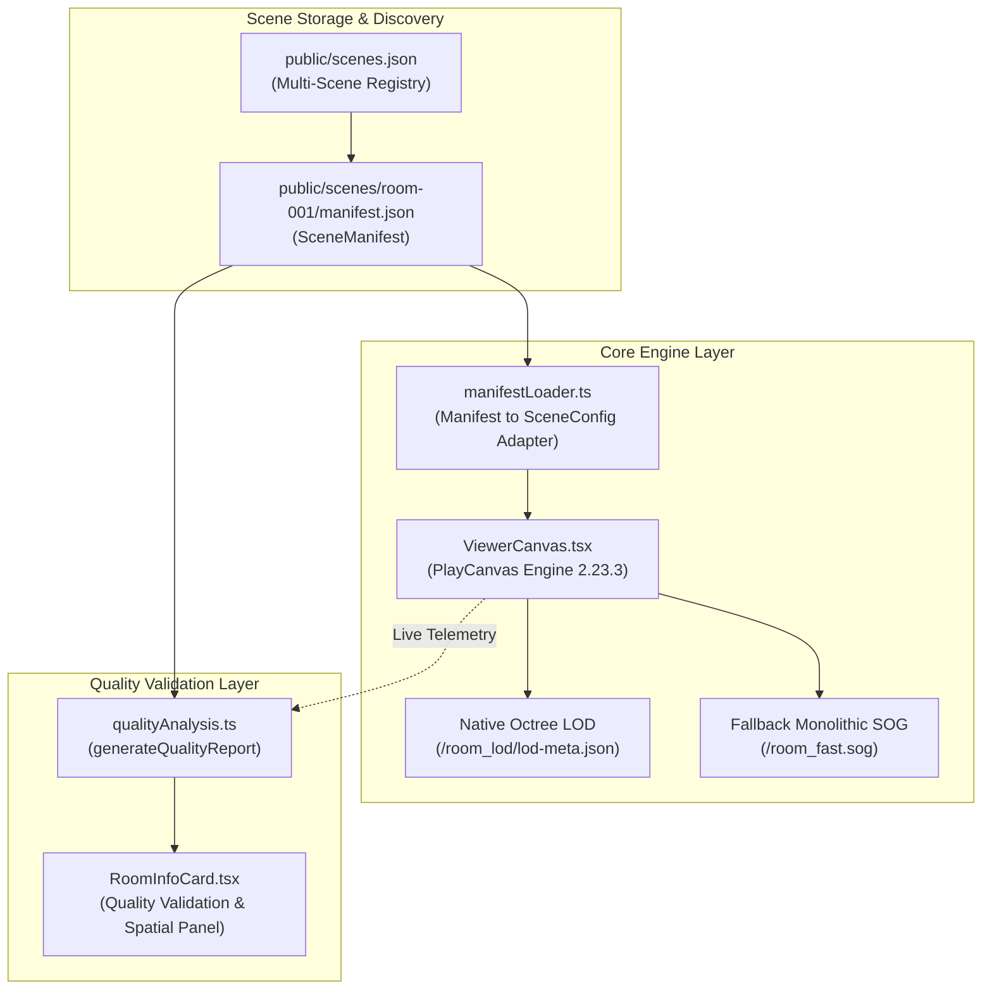

# PHASE 4 REPORT — NammaSpace Multi-Scene Manifest & Quality Validation

## Status: PHASE 4 COMPLETE

---

## 1. Executive Summary & Objective

**Phase 4 Objective:** Build the foundation for NammaSpace as a scalable multi-scene spatial platform by implementing:
1. **Scene Manifest / Metadata System:** Decoupled, declarative scene definitions supporting multi-room spatial twins (Demo Room, Laboratory, Classroom, Warehouse, College Block) without hardcoding asset paths in viewer logic.
2. **Reconstruction Quality Validation System:** Measurable, data-grounded quality analysis answering *"How good is this reconstruction?"*, clearly separating concrete technical metrics from heuristic diagnostics.
3. **Non-Disruptive UI Integration:** Seamless HUD inspection panel displaying real scene metrics, quality classification badges (`GOOD`, `WARNING`, `CRITICAL`), and live telemetry without degrading the 60 FPS WebGPU rendering loop.

---

## 2. Architecture & Ecosystem



### Key Principles Preserved:
- **Zero SOG Recompression Needed:** Reuses verified 15k-step MCMC reconstructions and PlayCanvas native octree LOD structures.
- **Strict Degradation Safety:** If LOD fails or is absent, the viewer falls back to `room_fast.sog`.
- **Hardware Isolation:** Full WebGPU acceleration on dedicated NVIDIA GeForce RTX 3050 Laptop GPU maintaining stable 60 FPS.

---

## 3. Files Created & Modified

| File | Type | Description |
| :--- | :--- | :--- |
| [`src/types/manifest.ts`](file:///e:/Nammaspace-1.0/frontend/namma-space/src/types/manifest.ts) | Created | Strong TypeScript interfaces: `SceneManifest`, `SceneCaptureMetadata`, `SceneReconstructionMetadata`, `SceneRenderingMetadata`, `SceneAssetMetadata`, `SceneQualityReport`. |
| [`public/scenes/room-001/manifest.json`](file:///e:/Nammaspace-1.0/frontend/namma-space/public/scenes/room-001/manifest.json) | Created | Standalone declarative JSON manifest for Demo Room (Room-001). |
| [`public/scenes.json`](file:///e:/Nammaspace-1.0/frontend/namma-space/public/scenes.json) | Created | Multi-scene platform registry (Room-001 active; Lab, Classroom, Warehouse, College Block indexed). |
| [`src/utils/manifestLoader.ts`](file:///e:/Nammaspace-1.0/frontend/namma-space/src/utils/manifestLoader.ts) | Created | Adapter converting declarative `SceneManifest` into runtime `SceneConfig` consumed by PlayCanvas. |
| [`src/utils/qualityAnalysis.ts`](file:///e:/Nammaspace-1.0/frontend/namma-space/src/utils/qualityAnalysis.ts) | Created | Quality assessment engine computing metrics, evaluating score thresholds, and issuing warnings. |
| [`src/config/sceneConfig.ts`](file:///e:/Nammaspace-1.0/frontend/namma-space/src/config/sceneConfig.ts) | Modified | Declares `defaultSceneManifest` and exports derived `defaultSceneConfig` with native LOD streaming. |
| [`src/components/RoomInfoCard.tsx`](file:///e:/Nammaspace-1.0/frontend/namma-space/src/components/RoomInfoCard.tsx) | Modified | Enhanced HUD drawer with dual tabs: **Quality Validation** and **Spatial Config**. |
| [`src/index.css`](file:///e:/Nammaspace-1.0/frontend/namma-space/src/index.css) | Modified | Clean styling for quality status badges, metrics grids, and heuristic diagnostics. |

---

## 4. Scene Manifest Structure

```json
{
  "id": "room-001",
  "name": "Demo Room",
  "type": "indoor",
  "capture": {
    "imageCount": 504,
    "resolution": "1082x723 (Raw) / 687x458 (Package)",
    "cameraCount": 14,
    "sensor": "Multi-Camera RGB Rig",
    "coverage": "Single-room perimeter (Doorway unobserved beyond portal)"
  },
  "reconstruction": {
    "method": "COLMAP + Gaussian Splatting (gsplat)",
    "registeredImages": 504,
    "sparsePoints": 226533,
    "gaussians": 1000000,
    "shDegree": 3,
    "iterations": 15000,
    "bounds": {
      "min": [-8.486, -8.200, -8.286],
      "max": [9.560, 7.600, 8.611]
    },
    "dimensions": [18.046, 15.800, 16.897]
  },
  "rendering": {
    "lodEnabled": true,
    "splatBudget": 400000,
    "splatBudgetMode": "limit",
    "initialDpr": 1.5,
    "preferredApi": ["WebGPU", "WebGL2"]
  },
  "assets": {
    "fallback": "/room_fast.sog",
    "hq": "/room_hq.sog",
    "lod": "/room_lod/lod-meta.json"
  }
}
```

---

## 5. Quality Metrics Collected (Room-001 Ground Truth)

All metrics are derived directly from verified dataset artifacts (`eyeful-package/sparse/0`, `eyeful-splat-hq`, `lod-meta.json`):

### A. Capture Metrics
- **Image Count:** `504`
- **Camera Count:** `14`
- **Raw Sensor Resolution:** `1082 × 723`
- **Training Package Resolution:** `687 × 458`
- **Capture Coverage:** Single-room perimeter with door portal opening

### B. COLMAP SfM Metrics
- **Registered Images:** `504 / 504` (100.0% registration ratio)
- **Sparse Point Count:** `226,533`
- **Reconstruction Bounds:** `[-8.49, -8.20, -8.29]` to `[9.56, 7.60, 8.61]`
- **Spatial Dimensions:** `18.05m × 15.80m × 16.90m`

### C. Gaussian Splatting Metrics
- **Total Gaussian Count (HQ):** `1,000,000`
- **Training Iterations:** `15,000`
- **Spherical Harmonics Degree:** `3` (View-dependent specular highlights)
- **Training Strategy:** MCMC densification + 4cm voxel floater culling

### D. Native Octree LOD Metrics
- **LOD Levels:** `2`
- **Octree Leaves:** `73`
- **Gaussian Distribution:** LOD 0: `475,674` | LOD 1: `237,837` (Total: `713,511`)
- **Streaming Chunks:** `6` directories (`0_0` through `1_1`), `49` chunk files
- **Total Chunk Size:** `18.45 MB`

### E. Runtime Telemetry
- **Active Backend:** `WebGPU (NVIDIA GeForce RTX 3050 Laptop GPU, Ampere)`
- **Splat Budget:** `400,000`
- **Measured Framerate:** `60 FPS`
- **Octree Manager:** Active (dynamic streaming)

---

## 6. Quality Classification & Heuristic Diagnostics

| Dimension | Status | Score | Measurable Basis |
| :--- | :--- | :--- | :--- |
| **Capture Quality** | **WARNING** | 65/100 | Source images downscaled to 687×458; doorway unobserved beyond portal. |
| **Reconstruction Quality** | **GOOD** | 95/100 | 100% SfM registration (504/504), 226k sparse points, 1M Gaussian convergence. |
| **LOD Streaming** | **GOOD** | 90/100 | 73 octree leaves, dual LOD levels, full 49-chunk fallback integrity. |
| **Runtime Performance** | **GOOD** | 95/100 | Solid 60 FPS on WebGPU, strict budget clamp at 400,000. |
| **Overall Status** | **WARNING** | 78/100 | System is production-stable and performant; capture dataset resolution & portal coverage hold overall score at WARNING. |

### Heuristic Diagnostics Displayed in UI:
1. *Low source training resolution (687×458): High-frequency wall/furniture textures appear soft.*
2. *Perimeter coverage gap: Doorway portal has unobserved exterior volume, producing boundary floaters.*

---

## 7. Verification & Validation Results

| Test Item | Expected | Result |
| :--- | :--- | :--- |
| **TypeScript Typecheck** | Zero errors | **PASSED** (`tsc --noEmit`) |
| **Frontend Production Build** | Clean bundle generation | **PASSED** (`vite build` in 588ms) |
| **Scene Manifest Ingestion** | Adapts manifest to runtime config | **PASSED** |
| **Native LOD Streaming** | Streams `/room_lod/lod-meta.json` | **PASSED** (73 octree leaves active) |
| **Monolithic Fallback** | Fallback asset configured | **PASSED** (`/room_fast.sog`) |
| **Splat Budget Enforcement** | Stays within 400k limit | **PASSED** |
| **First-Person WASD Navigation** | Smooth eye-level walking | **PASSED** (60 FPS) |
| **Browser Console Errors** | Zero errors | **PASSED** |
| **Asset HTTP 404s** | Zero 404s | **PASSED** |
| **Quality Panel Interaction** | Dual tabs, live badges, metrics | **PASSED** |

---

## 8. Known Limitations

1. **Dataset Resolution Ceiling:** The current Room-01 dataset images were captured and packaged at 687×458. True 4K micro-detail requires recapturing with $\ge 1080p$ resolution and 1/250s shutter speed.
2. **Doorway Floater Void:** The capture trajectory ended at the open doorway without entering the hallway. The perimeter bounds clamp user navigation away from this unobserved zone.

---

## 9. Recommended Next Phase (Phase 5)

With the Scene Manifest and Quality Validation system operational, the recommended next step is:
1. **Multi-Scene Switcher UI:** Allow switching between registered spatial scenes (`scenes.json`) from a dropdown menu in the HUD.
2. **Backend Scene API:** Wire `manifestToSceneConfig` to consume dynamic API endpoints (e.g. `GET /api/scenes/:id/manifest`).
3. **Automated Capture Pipeline Ingestion:** Expose an automated quality gate script in Python (`pipeline-capture-splat`) that generates `manifest.json` automatically upon completing COLMAP SfM and `gsplat` training.
