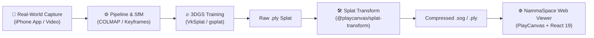

# NammaSpace (Nammaspace-1.0)

> **End-to-End 3D Gaussian Splatting (3DGS) & Spatial Computing Ecosystem**  
> From physical world capture to high-performance interactive web visualization.

> **Product restructure in progress:** NammaSpace is moving toward a homeowner/architect spatial modelling workbench with guided capture and three reviewable outputs: metric wireframe, solid geometry, then colors and object placeholders. The default frontend now opens the intake preview; the current PlayCanvas viewer remains available as a demo. See [`TODO.md`](./TODO.md), [`docs/SPATIAL_RESTRUCTURE_PLAN.md`](./docs/SPATIAL_RESTRUCTURE_PLAN.md), and [`spatial-engine/README.md`](./spatial-engine/README.md) for current scope and implementation status. The intake currently stages files in browser memory and does not upload or process them.

---

## 🌌 Overview

**NammaSpace** is a unified spatial computing workspace designed to bridge the entire lifecycle of **3D Gaussian Splatting (3DGS)**:
1. **Real-World Capture**: Guided iPhone LiDAR and video capture.
2. **Reconstruction & Training**: SfM (COLMAP) and neural splat generation via Vulkan (`VkSplat`) and CUDA (`gsplat`).
3. **Asset Transformation**: High-speed compression, filtering, and formatting into web-optimized `.sog` and `.ply` splats.
4. **Interactive Web Visualization**: Ultra-smooth, responsive 3DGS web viewer powered by **React 19**, **PlayCanvas React**, and **Vite**.
5. **Research & Benchmarks**: Curated state-of-the-art literature and taxonomy on 3DGS innovations.

---

## 🏗️ Architecture & Ecosystem



The workspace consists of four modular sub-systems:

| Subsystem | Directory | Purpose | Primary Tech Stack |
| :--- | :--- | :--- | :--- |
| **NammaSpace Web Viewer** | [`namma-space/`](./namma-space) | Client-side interactive 3D splat viewer with orbit controls & debug inspector | React 19, TypeScript, Vite, `@playcanvas/react`, PlayCanvas Engine |
| **Capture & Training Pipeline** | [`pipeline-capture-splat/`](./pipeline-capture-splat) | iOS capture app, frame selection, COLMAP export, and Vulkan/CUDA 3DGS training | Swift/iOS, Python 3, COLMAP, VkSplat (Vulkan), gsplat (CUDA) |
| **Splat Transform Tooling** | [`tool-splat-transform/`](./tool-splat-transform) | CLI and library for 3DGS format conversion, bounding-box cropping, and `.sog` compression | TypeScript, Node.js, Rollup, PlayCanvas |
| **3DGS Research Base** | [`research-awesome-3dgs/`](./research-awesome-3dgs) | Research papers, algorithmic comparisons, and state-of-the-art 3DGS surveys | YAML, Python, Markdown |

---

## 📁 Repository Layout

```text
Nammaspace-1.0/
├── namma-space/                 # 🌐 Web application & 3DGS viewer
│   ├── src/
│   │   ├── App.tsx              # Main splat canvas & camera controls
│   │   ├── inspector.ts         # PlayCanvas live debug inspector
│   │   └── main.tsx             # React entry point
│   ├── package.json
│   └── vite.config.ts
│
├── pipeline-capture-splat/      # 📱 Capture & reconstruction pipeline
│   ├── apps/ios/CaptureSplat/   # Native iOS capture application
│   ├── python/                  # Frame curation, SfM, and training runners
│   └── docs/                    # Field validation & handoff specs
│
├── tool-splat-transform/        # 🛠️ 3DGS optimization CLI & library
│   ├── bin/cli.mjs              # splat-transform executable
│   ├── src/                     # Compression, conversion, and parsing logic
│   └── package.json
│
└── research-awesome-3dgs/       # 📚 Comprehensive 3DGS research tracker
    ├── awesome_3dgs_papers.yaml
    └── README.md
```

---

## 🚀 Quickstart Guides

### 1. Interactive Web Viewer (`namma-space`)

Launch the local development viewer to explore 3D Gaussian Splats in your browser:

```bash
# Navigate to the web application directory
cd namma-space

# Install dependencies
npm install

# Start development server
npm run dev
```

Open `http://localhost:5173` in your browser.
- **First-Person Walking**: Click the canvas to enter FPS look. Use <kbd>W</kbd><kbd>A</kbd><kbd>S</kbd><kbd>D</kbd> to walk, <kbd>Space</kbd>/<kbd>E</kbd> to fly up, and <kbd>C</kbd>/<kbd>Q</kbd> to fly down. Hold <kbd>Shift</kbd> to sprint.
- **Speed Tuning**: Press <kbd>[</kbd> to slow down or <kbd>]</kbd> to speed up in real-time.
- **PlayCanvas Inspector**: Press the backquote key (<kbd>`</kbd>) to toggle the real-time hierarchy, asset inspector, performance graphs, and material settings.
- **Controls**: Press <kbd>F9</kbd> to pause rendering, and <kbd>F10</kbd> to advance frame-by-frame.

#### Viewing Custom Splats
1. Export or download your `.sog` or `.ply` file.
2. Place it in `frontend/namma-space/public/` or host it via a remote URL.
3. Update scene presets or default splat URL in [`frontend/namma-space/src/config/sceneConfig.ts`](./frontend/namma-space/src/config/sceneConfig.ts):
   ```tsx
   export const supermarketSceneConfig = ...
   ```

---

### 2. Splat Format Conversion & Compression (`tool-splat-transform`)

Convert raw high-polygon 3DGS `.ply` files into compressed `.sog` format (up to 10x smaller, ideal for web delivery):

```bash
cd tool-splat-transform

# Install dependencies and build CLI binary
npm install
npm run build

# Convert a PLY to optimized SOG
node bin/cli.mjs input.ply output.sog
```

Features supported by `splat-transform`:
- Spherical harmonic truncation for compact downloads.
- Coordinate system adjustments (Y-up / Z-up).
- Bounding-box cropping to isolate objects and remove noisy backgrounds.

---

### 3. Capture & Training Pipeline (`pipeline-capture-splat`)

For capturing real-world environments with an iPhone and training custom splats:

#### A. Environment Setup
Activate the Python virtual environment:
```powershell
cd pipeline-capture-splat

# Windows PowerShell:
.\.venv\Scripts\Activate.ps1

# Windows CMD:
.\.venv\Scripts\activate.bat

# Linux / macOS:
source .venv/bin/activate
```

#### B. iOS Capture
1. Open `apps/ios/CaptureSplat/CaptureSplat.xcodeproj` in Xcode.
2. Build and run on a physical iPhone with LiDAR support.
3. Record with the **Video 3DGS** mode using slow, overlapping arcs.
4. Transfer the capture folder to your workstation.

#### C. Reconstruction Preparation & Quality Gate
```bash
# Check all available CLI options
python -m capture_splat --help

# Generate a capture quality report
python -m capture_splat capture-quality-report --capture /path/to/capture

# Plan reconstruction budget and matching strategy
python -m capture_splat plan-reconstruction --capture /path/to/capture --out runs/plan

# Curate sharp keyframes and prepare SfM package
python -m capture_splat prepare-capture --capture /path/to/capture --out runs/prepared
```

#### D. 3DGS Training (CUDA via `gsplat` / Vulkan via `VkSplat`)

Train using the CUDA `gsplat` simple trainer:
```bash
# View trainer options
python external/gsplat-v1.5.3/examples/simple_trainer.py --help

# Train on a COLMAP dataset
python external/gsplat-v1.5.3/examples/simple_trainer.py default --data_dir /path/to/colmap_data --result_dir runs/splat_output
```

Or train using the `capture-splat` Vulkan ladder runner:
```bash
python -m capture_splat train-vksplat-ladder --package runs/prepared --out runs/trained
```

The output produces a standard 3DGS `.ply` file ready for `splat-transform` compression and `namma-space` visualization.

---

## ⚡ Key Highlights

- **Web-First Performance**: Uses fragment-optimized splat shaders without costly MSAA overhead, ensuring 60+ FPS on laptops, desktops, and mobile browsers.
- **Hardware-Agnostic Training**: Supports cross-platform training across Apple Silicon (Metal/Vulkan), Linux, and Windows via VkSplat, with CUDA fallbacks for cloud clusters.
- **Zero-Friction Compression**: Integrated conversion to `.sog`, drastically reducing network bandwidth for spatial web streaming.
- **Developer-Friendly Ergonomics**: Fully typed with TypeScript, instantaneous HMR with Vite, and built-in runtime debugging with PlayCanvas Inspector.

---

## 📜 License & Acknowledgments

- **NammaSpace Web Viewer**: Built with [PlayCanvas](https://playcanvas.com/) & [React](https://react.dev/).
- **Capture Splat**: Based on [`capture-splat`](https://github.com/sandeep-devarapalli/capture-splat).
- **Splat Transform**: [`@playcanvas/splat-transform`](https://github.com/playcanvas/splat-transform).
- **Research**: References maintained from [`awesome-3D-gaussian-splatting`](https://github.com/MrNeRF/awesome-3D-gaussian-splatting).
