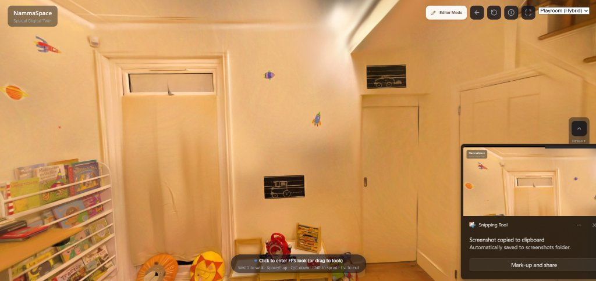
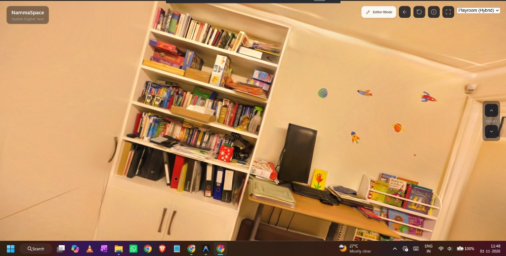
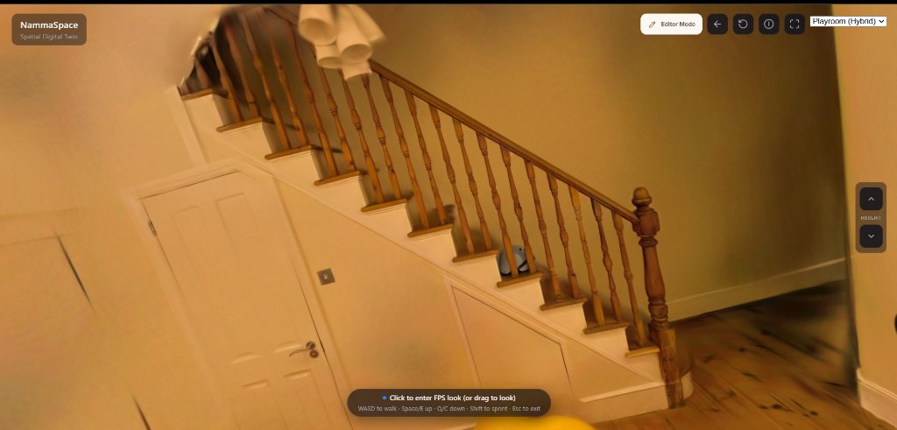
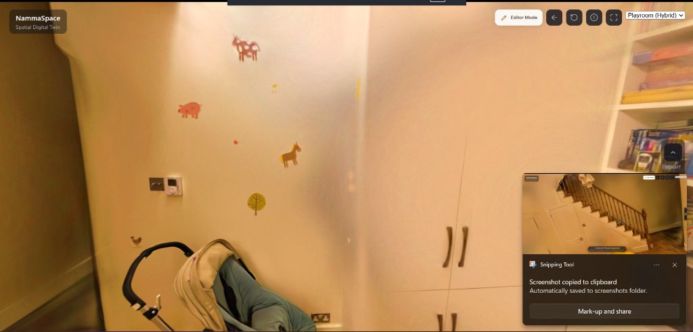
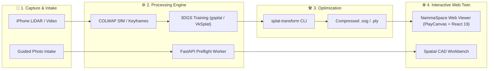

# 🌌 NammaSpace (`Nammaspace-1.0`)

<div align="center">



### **Interactive 3D Gaussian Splatting (3DGS) & Spatial Computing Ecosystem**
*From real-world mobile capture to photorealistic, high-performance interactive web digital twins.*

[](https://github.com/atharva5645/nammaspace-1.0/stargazers)
[](LICENSE)
[](https://react.dev/)
[](https://playcanvas.com/)
[](https://fastapi.tiangolo.com/)

[**Live Demo & Web Viewer**](#-interactive-web-viewer-demo) • [**Architecture**](#-architecture--ecosystem) • [**Showcase Gallery**](#-spatial-gallery--captures) • [**Quickstart**](#-quickstart-guides) • [**Deployment**](#-cloud-deployment-render)

</div>

---

> [!NOTE]
> **Spatial Restructure in Progress:** NammaSpace is expanding toward an architect-grade spatial modelling workbench with guided capture, metric wireframe reconstruction, and solid geometry workflows. The default frontend now hosts the guided spatial intake preview, while the high-fidelity PlayCanvas 3DGS viewer remains fully accessible. See [`TODO.md`](./TODO.md) and [`docs/SPATIAL_RESTRUCTURE_PLAN.md`](./docs/SPATIAL_RESTRUCTURE_PLAN.md).

---

## 📸 Spatial Gallery & Captures

Experience photorealistic, real-world Gaussian splats rendered in real-time in the browser at 60+ FPS:

<table>
  <tr>
    <td width="50%" align="center">
      
      <br />
      <b>Sub-millimeter Detail & Baked Bookshelf Elements</b>
    </td>
    <td width="50%" align="center">
      
      <br />
      <b>Full Room Walkthrough with First-Person (FPS) Controls</b>
    </td>
  </tr>
  <tr>
    <td width="50%" align="center">
      
      <br />
      <b>Complex Architectural Geometry & Staircase Banisters</b>
    </td>
    <td width="50%" align="center">
      
      <br />
      <b>Soft Shadows, Natural Sunlight Ingress & Ambient Occlusion</b>
    </td>
  </tr>
</table>

---

## 🌟 Key Features

- 🎮 **Ultra-Fluid WebGL / WebGPU Viewer**: Powered by **PlayCanvas Engine** and **React 19**, rendering millions of Gaussians smoothly on desktops, laptops, and mobile devices without MSAA penalties.
- 🚶 **First-Person & Orbit Navigation**: Seamless switch between immersive WASD FPS walkthrough mode, fly mode, and inspection orbit mode.
- 📐 **Spatial Workbench & Metric Wireframe**: Dimension-driven spatial reconstruction drafts, plane detection, and anchor measurements for CAD and architectural workflows.
- ⚡ **Compressed `.sog` Asset Pipeline**: Convert bulky `.ply` splats into streamable, web-optimized `.sog` format with up to **10x compression**.
- 🛠️ **Full Capture-to-Training Pipeline**: iPhone LiDAR/video recording, keyframe extraction, COLMAP camera registration, and CUDA/Vulkan (`gsplat` / `VkSplat`) training runners.
- 🔍 **Real-Time Editor & Inspector**: Built-in visual transform gizmos, live scene hierarchy, splat density controls, and performance diagnostics (<kbd>`</kbd> key).

---

## 🏗️ Architecture & Ecosystem



### Modular Directory Structure

| Subsystem | Directory | Purpose | Primary Tech Stack |
| :--- | :--- | :--- | :--- |
| **Web Viewer & Workbench** | [`frontend/namma-space/`](./frontend/namma-space) | Client-side 3DGS web viewer, editor panel, and intake UI | React 19, TypeScript, Vite, `@playcanvas/react` |
| **Backend API & Workers** | [`backend/api/`](./backend/api) | Capture intake API, resumable chunk uploads, preflight worker | FastAPI, Uvicorn, SQLite, Pillow-HEIF |
| **Spatial Engine** | [`spatial-engine/`](./spatial-engine) | Metric wireframes, coordinate solvers, and reconstruction contracts | Python 3, NumPy, JSON Schemas |
| **Capture & Training Pipeline**| [`pipeline-capture-splat/`](./pipeline-capture-splat) | iOS capture app, frame curation, SfM, and Vulkan/CUDA trainers | Swift/iOS, Python 3, COLMAP, VkSplat, gsplat |
| **Splat Transform Tooling** | [`tool-splat-transform/`](./tool-splat-transform) | CLI for 3DGS coordinate conversion, cropping, and `.sog` compression | TypeScript, Node.js, PlayCanvas |

---

## 🚀 Quickstart Guides

### 1. Web Viewer (`frontend/namma-space`)

Launch the web viewer locally:

```bash
cd frontend/namma-space
npm install
npm run dev
```

Open `http://localhost:5173` in your browser.

#### Controls Cheat Sheet:
- **Click Canvas**: Enter first-person look
- <kbd>W</kbd> <kbd>A</kbd> <kbd>S</kbd> <kbd>D</kbd>: Walk / strafe
- <kbd>Space</kbd> / <kbd>E</kbd>: Fly up
- <kbd>C</kbd> / <kbd>Q</kbd>: Fly down
- <kbd>Shift</kbd>: Sprint boost
- <kbd>[</kbd> / <kbd>]</kbd>: Decrease / increase movement speed
- <kbd>`</kbd> (Backquote): Toggle PlayCanvas live debug inspector

---

### 2. Backend & Worker (`backend/api`)

Run the intake API and background spatial worker:

```bash
# Terminal 1: FastAPI Web Server
cd backend/api
pip install -r requirements.txt
uvicorn app.main:app --port 8000 --reload

# Terminal 2: Background Spatial Preflight Worker
cd backend/api
python -m app.worker
```

Verify service status: `curl http://127.0.0.1:8000/health` → `{"status":"ok","service":"capture-api"}`

---

### 3. Splat Format Conversion & Compression (`tool-splat-transform`)

Convert raw high-density 3DGS `.ply` files into compressed `.sog` files:

```bash
cd tool-splat-transform
npm install && npm run build

# Convert and compress
node bin/cli.mjs input.ply output.sog
```

---

## ☁️ Cloud Deployment (Render)

This repository is ready for multi-service deployment on [Render](https://render.com):

<details>
<summary><b>Click to expand Render Deployment Steps</b></summary>

1. **Deploy Backend (Web Service):**
   - **Repository:** `https://github.com/atharva5645/nammaspace-1.0.git`
   - **Root Directory:** `backend/api`
   - **Runtime:** `Python 3`
   - **Build Command:** `pip install -r requirements.txt`
   - **Start Command:** `uvicorn app.main:app --host 0.0.0.0 --port $PORT`
   - **Environment Variables:**
     - `APP_ENV`: `development`
     - `ALLOWED_ORIGINS`: `*` (or your frontend domain)
     - `DEV_AUTH_TOKEN`: `<your-secret-token>`

2. **Deploy Frontend (Static Site):**
   - **Repository:** `https://github.com/atharva5645/nammaspace-1.0.git`
   - **Root Directory:** `frontend/namma-space`
   - **Build Command:** `npm install && npm run build`
   - **Publish Directory:** `dist`
   - **Environment Variables:**
     - `VITE_NAMMASPACE_API_URL`: `https://<your-backend-service>.onrender.com`
     - `VITE_DEV_API_TOKEN`: `<your-secret-token>`

</details>

---

## 📜 Acknowledgments

- **PlayCanvas**: Next-generation web-first graphics engine.
- **gsplat** & **VkSplat**: High-performance CUDA and cross-platform Vulkan 3DGS training engines.
- **Capture Splat**: iOS and COLMAP integration foundation.
