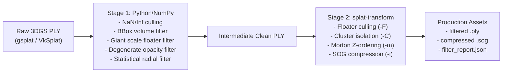

# NammaSpace 3DGS Filter & Transformation Pipeline

An independent, non-destructive filtering and asset transformation module designed to clean raw 3D Gaussian Splatting `.ply` reconstructions and prepare production-ready `.ply` and `.sog` assets for the NammaSpace WebGPU viewer.

---

## 🛡️ Project Safety & Preservation Rules

- **Independent Module:** Resides entirely in [`pipeline/filter/`](file:///e:/Nammaspace-1.0/pipeline/filter) without modifying COLMAP, gsplat 1.5.3, CUDA/PyTorch, PlayCanvas viewer, scene manifests, or frontend systems.
- **Zero Heavy Dependency Mutation:** Uses Python standard library + NumPy for in-memory operations and existing local Node.js `@playcanvas/splat-transform` tooling for post-processing.
- **Asset Integrity:** Never modifies existing production scans (`Room-001`, `room-001-1k`, etc.).
- **Staged Validation:** All filters and tools are unit-tested and validated on synthetic test assets before running on real captures.

---

## 🏗️ Architecture



---

## 🚀 CLI Usage

### 1. Audit Installed Tooling
Verifies that `@playcanvas/splat-transform` is located and functioning:
```bash
python -m pipeline.filter.cli --check-tools
```

### 2. Generate Synthetic Test Asset
Produces a small synthetic 3DGS PLY with controlled anomalies (NaNs, bbox outliers, giant scale floaters, degenerate opacities) for validation:
```bash
python -m pipeline.filter.cli --generate-synthetic sample_test.ply
```

### 3. Dry Run Execution
Validates configuration and input file availability without writing outputs:
```bash
python -m pipeline.filter.cli -i input.ply -o output/ --bbox-min -10 -10 -10 --bbox-max 10 10 10 --dry-run
```

### 4. Full Multi-Stage Execution
Executes Stage 1 and Stage 2, producing filtered PLY, SOG, and telemetry report:
```bash
python -m pipeline.filter.cli \
  -i input.ply \
  -o output/ \
  --bbox-min -5 -5 -5 \
  --bbox-max 5 5 5 \
  --name my_scene_filtered
```

---

## 🧪 Testing

Run the isolated test suite:
```bash
python -m unittest discover -s pipeline/filter/tests
```
